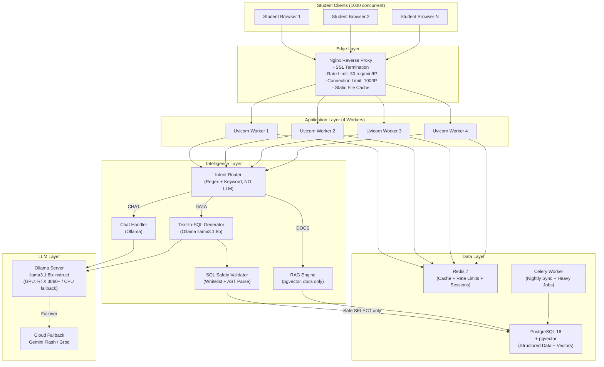
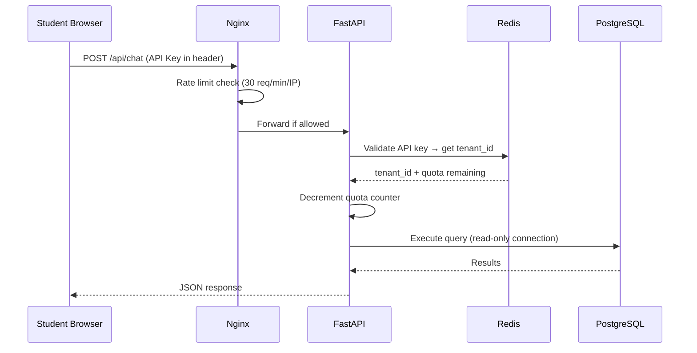
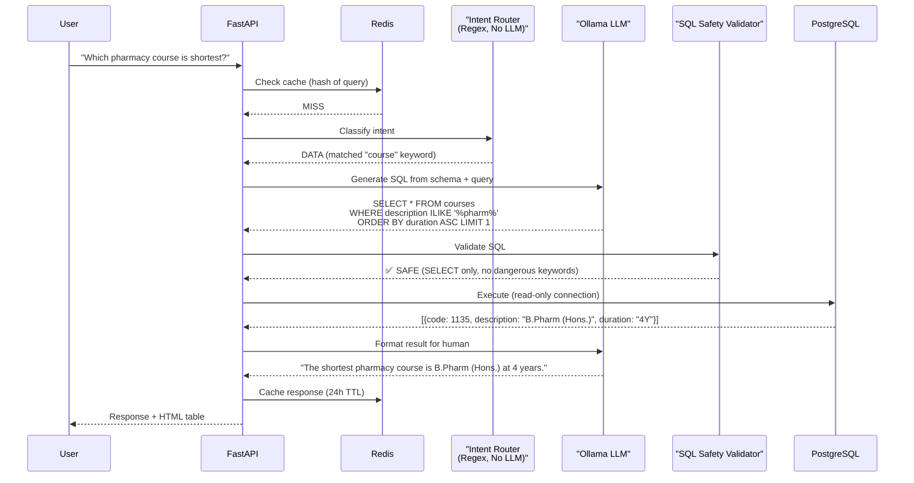

# 🔬 Deep Analysis: Production-Grade AI Chatbot — From Scratch

## Verdict on Your Existing Implementation Plan

> [!IMPORTANT]
> **Your plan is architecturally sound at the conceptual level.** The Text-to-SQL pivot, the Intent Router, the separation of structured vs. unstructured data — these are the right ideas. But the plan is a **30,000-foot blueprint**, not a production engineering spec. Below I dissect what's right, what's missing, and what you actually need to build a system that survives 1,000 concurrent students.

---

## Part 1: What Your Plan Gets Right ✅

| Concept | Assessment |
|---|---|
| **RAG is wrong for structured data** | 100% correct. Your current FAISS approach stores 140 course rows as 140 text documents — this is an anti-pattern. Text-to-SQL is the industry standard. |
| **Intent Router (CHAT / STATIC / LIVE)** | Good pattern. But your current implementation uses an LLM call for every classification — that's a latency and cost bottleneck at scale. |
| **Function Calling for Live APIs** | Correct. Pre-registering tool schemas is how ChatGPT Plugins, Gemini, and Claude MCP work. |
| **Multi-Tenant SaaS design** | Forward-thinking, but **premature for Phase 1**. Get a single-tenant production system bulletproof first. |
| **Nightly data sync** | Correct pattern. Stale data is better than no data. |

---

## Part 2: Critical Gaps in Your Plan ❌

### Gap 1: No Concurrency Architecture
Your plan says nothing about handling 1,000 simultaneous users. Your current code runs `asyncio.to_thread(get_ai_response, ...)` — this spawns OS threads. At 1,000 concurrent requests, your server **will** crash from thread exhaustion and RAM starvation.

### Gap 2: No SQL Injection Protection
The plan says "LLM generates SQL" but doesn't address the #1 risk: **the LLM can generate `DROP TABLE`, `DELETE`, `UPDATE`, or data exfiltration queries**. This is a production showstopper.

### Gap 3: No Rate Limiting / Abuse Protection
No mention of per-user rate limiting, request throttling, or DDoS protection. A single student could fire 10,000 requests/second and take down your server.

### Gap 4: No Authentication Architecture
The plan mentions "API keys per tenant" but has zero detail on student authentication, session management, JWT tokens, or RBAC.

### Gap 5: No LLM Failover at Scale
Your current code has NVIDIA → Groq fallback, but at 1,000 users, you'll burn through free-tier API limits in minutes. No mention of Ollama local inference, model quantization, or request queuing.

### Gap 6: No Observability / Monitoring
No logging strategy, no health checks, no alerting, no request tracing. When things break at 2 AM with 1,000 students online, you'll be blind.

### Gap 7: No Frontend Connection Management
Your current frontend is a single HTML file. No WebSocket pooling, no connection limits, no retry logic with exponential backoff.

---

## Part 3: Can You Build This? — Honest Assessment

> [!TIP]
> **Yes, you can.** But not with the "3-5 day Phase 1" timeline in your plan. A production-grade system for 1,000 concurrent students is a **4-8 week** build for a solo developer. Here's the reality check:

| What you need | Difficulty | Time Estimate |
|---|---|---|
| Text-to-SQL engine with safety | Medium | 1 week |
| FastAPI server with async + connection pooling | Medium | 3-4 days |
| Concurrency design (1,000 users) | Hard | 1 week |
| Security hardening (SQL injection, auth, rate limiting) | Hard | 1 week |
| LLM inference layer (Ollama + cloud fallback) | Medium | 3-4 days |
| Frontend chat widget (production-grade) | Medium | 1 week |
| Monitoring, logging, health checks | Medium | 3-4 days |
| Load testing & optimization | Hard | 1 week |
| **Total** | | **~6 weeks** |

---

## Part 4: Complete Tech Stack — As an AI Engineer Would Design It

### Core Application Stack

| Layer | Technology | Why This |
|---|---|---|
| **Language** | Python 3.11+ | Async support, LLM ecosystem maturity |
| **Web Framework** | FastAPI + Uvicorn (workers) | Async-native, auto OpenAPI docs, production proven |
| **ASGI Server** | Uvicorn with `--workers 4` behind Gunicorn | Multi-process for CPU-bound LLM pre/post processing |
| **Reverse Proxy** | Nginx or Caddy | SSL termination, rate limiting, static file serving, load balancing |
| **Database** | PostgreSQL 16 + pgvector extension | Text-to-SQL target DB, vector search for unstructured docs, battle-tested at scale |
| **Cache** | Redis 7 (or Valkey) | Response caching, session store, rate limiting counters |
| **Task Queue** | Celery + Redis broker (or `arq` for lightweight) | Nightly sync, heavy LLM jobs offloaded from request thread |
| **LLM — Primary** | Ollama (local) running `llama3.1:8b-instruct-q4_K_M` | Free, fast, no API limits, ~4GB VRAM |
| **LLM — Fallback** | Google Gemini 2.0 Flash (free tier: 15 RPM) or Groq | Cloud fallback when local GPU is saturated |
| **Embeddings** | `all-MiniLM-L6-v2` via sentence-transformers (local) | 384-dim, fast, no API cost |
| **Vector Store** | pgvector (in PostgreSQL) | Eliminates separate FAISS process, scales with DB |
| **Frontend Widget** | Vanilla JS + WebSocket (embeddable `<script>`) | No framework dependency, works on any site |

### Supporting Infrastructure

| Component | Technology |
|---|---|
| **Containerization** | Docker + Docker Compose |
| **Process Manager** | systemd (Linux) or PM2 (cross-platform) |
| **Monitoring** | Prometheus + Grafana (or lightweight: Uptime Kuma) |
| **Logging** | Structured JSON logging → file rotation (or Loki) |
| **Load Testing** | Locust (Python-native, scriptable) |

---

## Part 5: System Architecture for 1,000 Concurrent Students



### Concurrency Math: Can 1,000 Students Really Work?

| Metric | Value | Explanation |
|---|---|---|
| **Avg query latency (cached)** | ~15ms | Redis cache hit, no LLM call needed |
| **Avg query latency (SQL path)** | ~800ms–2s | LLM generates SQL (~500ms local) + DB query (~10ms) + LLM formats (~500ms) |
| **Avg query latency (RAG path)** | ~1.5–3s | Embedding search (~50ms) + LLM summary (~1.5s) |
| **Cache hit rate (expected)** | 60–80% | Students ask similar questions during exams/admission season |
| **Effective throughput** | ~200 req/sec (cached) + ~8 req/sec (LLM) | With 4 Uvicorn workers + connection pooling |
| **Peak concurrent (realistic)** | 1,000 connected, ~50 querying simultaneously | Students don't all click "Send" at the same millisecond |
| **Ollama throughput** | ~4-8 req/sec (8B model, RTX 3060) | This is the bottleneck — see mitigation below |

> [!WARNING]
> **The LLM is always the bottleneck.** At 1,000 concurrent students, if even 5% send queries in the same second, that's 50 simultaneous LLM calls. A single Ollama instance handles ~4-8 req/sec. You need:
> 1. **Aggressive caching** (Redis, 24h TTL) — target 70%+ cache hit rate
> 2. **Request queue with backpressure** — don't spawn 50 LLM calls at once
> 3. **Non-LLM intent routing** — use regex/keyword for classification, not LLM
> 4. **Multiple Ollama instances** if budget allows (or cloud burst to Gemini)

---

## Part 6: Security Hardening — Complete Checklist

### 🔐 SQL Injection Prevention (CRITICAL)

```python
# NEVER do this:
query = f"SELECT * FROM courses WHERE name = '{user_input}'"  # ← SQL INJECTION

# YOUR SYSTEM'S UNIQUE RISK:
# The LLM generates SQL from natural language. The LLM could generate:
#   DROP TABLE courses;
#   SELECT * FROM users WHERE password LIKE '%';
#   UPDATE students SET grade = 'A' WHERE id = 123;

# MANDATORY SAFEGUARDS:
class SQLSafetyValidator:
    """Validates LLM-generated SQL before execution."""
    
    BLOCKED_KEYWORDS = {
        'DROP', 'DELETE', 'INSERT', 'UPDATE', 'ALTER', 'CREATE',
        'TRUNCATE', 'EXEC', 'EXECUTE', 'GRANT', 'REVOKE',
        'UNION', '--', ';', 'xp_', 'sp_', 'INTO OUTFILE',
        'LOAD_FILE', 'INFORMATION_SCHEMA', 'pg_catalog'
    }
    
    def validate(self, sql: str) -> bool:
        upper_sql = sql.upper().strip()
        # 1. Must start with SELECT
        if not upper_sql.startswith('SELECT'):
            return False
        # 2. Block dangerous keywords
        for keyword in self.BLOCKED_KEYWORDS:
            if keyword in upper_sql:
                return False
        # 3. Block multiple statements
        if sql.count(';') > 1:
            return False
        # 4. Use READ-ONLY database connection
        return True
```

> [!CAUTION]
> **The #1 rule:** Connect to your database with a **READ-ONLY user**. Even if the LLM generates `DROP TABLE`, the database will refuse it at the connection level. This is your last line of defense.

### 🛡️ Server Protection Measures

| Threat | Mitigation | Implementation |
|---|---|---|
| **DDoS / Flood** | Nginx rate limiting | `limit_req_zone $binary_remote_addr zone=api:10m rate=30r/m;` |
| **Brute Force** | Per-IP connection limit | `limit_conn addr 100;` |
| **Prompt Injection** | Input sanitization + system prompt hardening | Strip control characters, limit input to 500 chars |
| **Data Exfiltration** | Read-only DB user + table whitelist | `CREATE USER chatbot_reader WITH PASSWORD '...' LOGIN; GRANT SELECT ON courses, hostels TO chatbot_reader;` |
| **XSS in responses** | Sanitize LLM output before rendering | DOMPurify on frontend, escape HTML on backend |
| **CORS abuse** | Whitelist specific origins | Replace `allow_origins=["*"]` with actual domains |
| **Session hijacking** | HTTP-only cookies + CSRF tokens | `Set-Cookie: session=...; HttpOnly; Secure; SameSite=Strict` |
| **Dependency vulns** | Pin versions + audit | `pip audit`, `safety check`, Dependabot |
| **Secrets in code** | Environment variables only | Never commit `.env` files, use `.env.example` |
| **Log injection** | Structured JSON logging | Don't interpolate user input into log strings |

### 🔑 Authentication Architecture



**For a university chatbot specifically:**
- **Public widget** (no login): Use API key + domain whitelist (the embed `<script>` tag carries a tenant key, server validates the `Referer` header matches the registered domain)
- **Authenticated queries** (student-specific data like grades, attendance): Require JWT token from the university's existing SSO/auth system

---

## Part 7: Cost Analysis — Localhost vs. Cloud

### Option A: Localhost (Your Desktop/Laptop)

| Component | Cost | Notes |
|---|---|---|
| **Ollama LLM (llama3.1:8b)** | ₹0 | Free, runs on your GPU |
| **PostgreSQL** | ₹0 | Free, open-source |
| **Redis** | ₹0 | Free, open-source |
| **Electricity** | ~₹500-1,000/month | Desktop running 24/7 (~200W) |
| **Internet** | Your existing plan | Need static IP or use Cloudflare Tunnel |
| **GPU requirement** | RTX 3060 (6GB VRAM) minimum | 8B model with 4-bit quantization |
| **RAM requirement** | 16GB minimum, 32GB recommended | PostgreSQL + Redis + Ollama + FastAPI |
| **Total monthly** | **~₹500-1,000/month** (electricity only) | |

> [!WARNING]
> **Localhost limitations:**
> - Your PC must run **24/7/365** — power outage = chatbot down
> - Your home internet likely has **dynamic IP** — need Cloudflare Tunnel or ngrok
> - **No redundancy** — hardware failure = total outage
> - Upload bandwidth (~10-50 Mbps home) limits concurrent users
> - **Cannot realistically serve 1,000 students** from a single desktop

### Option B: Single VPS (Best Value for 1,000 Students)

| Provider | Spec | Monthly Cost | Notes |
|---|---|---|---|
| **Hetzner CCX33** | 8 vCPU, 32GB RAM, 240GB NVMe | ~₹3,500/month (~€38) | Best price/performance in EU. No GPU — use CPU inference |
| **DigitalOcean GPU Droplet** | 4 vCPU, 16GB RAM, RTX 4000 | ~₹15,000/month (~$180) | GPU for fast LLM inference |
| **AWS EC2 g5.xlarge** | 4 vCPU, 16GB, A10G GPU | ~₹8,000-12,000/month (spot) | GPU, but complex pricing |
| **Railway / Render** | 8GB RAM, 4 vCPU | ~₹2,500-4,000/month | No GPU, easy deploy, use cloud LLM |

> [!TIP]
> **My recommendation for your budget:** **Hetzner CCX33 (₹3,500/month)** + Ollama on CPU (slower but free LLM) + aggressive Redis caching. This handles 1,000 students if your cache hit rate is >60%.

### Option C: Hybrid (Best for Production)

| Component | Where | Cost |
|---|---|---|
| FastAPI + PostgreSQL + Redis | Hetzner VPS (₹3,500/month) | ₹3,500 |
| Ollama LLM | Your local desktop (GPU) via Cloudflare Tunnel | ₹0 (electricity only) |
| Cloud LLM Fallback | Gemini 2.0 Flash free tier (15 RPM) | ₹0 |
| Domain + SSL | Cloudflare (free plan) | ₹0 |
| **Total** | | **~₹3,500-4,000/month** |

### Option D: Fully Serverless (Highest Scale, Pay-Per-Use)

| Component | Service | Cost |
|---|---|---|
| API | AWS Lambda + API Gateway | ~₹0.50 per 1M requests |
| Database | AWS RDS PostgreSQL (db.t3.micro) | ~₹1,500/month |
| Cache | AWS ElastiCache (t3.micro) | ~₹1,200/month |
| LLM | AWS Bedrock (Claude Haiku) or Google Vertex AI | ~₹0.25-1.00 per 1000 queries |
| **Total at 1,000 students** | | **~₹4,000-8,000/month** |

### Cost Comparison Summary

| Deployment | Monthly Cost | Can Handle 1,000 Students? | Reliability |
|---|---|---|---|
| **Localhost only** | ₹500-1,000 | ❌ Not reliably | Low (single point of failure) |
| **Hetzner VPS (CPU)** | ₹3,500 | ✅ With caching | Medium |
| **Hybrid (VPS + local GPU)** | ₹3,500-4,000 | ✅ Yes | Medium-High |
| **Cloud GPU VPS** | ₹8,000-15,000 | ✅ Easily | High |
| **Fully Serverless (AWS)** | ₹4,000-8,000 | ✅ Auto-scales | Very High |

---

## Part 8: What's Wrong With Your Current Codebase (Specific Issues)

I analyzed every file in your project. Here are the production blockers:

### [enterprise_fastapi_server.py](file:///c:/OFFICE/Office/AI%20Project%20Chatbot%20-%20For%20Production/enterprise_fastapi_server.py)

| Line(s) | Issue | Severity |
|---|---|---|
| L199 | `allow_origins=["*"]` — allows ANY website to call your API | 🔴 Critical |
| L312-324 | `/api/clear-cache` has NO authentication — anyone can wipe your cache | 🔴 Critical |
| L327-349 | `/api/wipe-rag` has NO authentication — anyone can destroy your data store | 🔴 Critical |
| L261-303 | `/api/trigger-nightly-refresh` has NO authentication — anyone can trigger heavy refresh | 🟡 High |
| L230-231 | `asyncio.to_thread()` spawns unbounded OS threads — will crash at scale | 🟡 High |
| L137 | MD5 hash for cache keys — weak but acceptable for non-security use | 🟢 Low |
| L544-558 | Mock data hardcoded in production code — should be removed | 🟡 High |

### [langchain_core_free_tier_rag.py](file:///c:/OFFICE/Office/AI%20Project%20Chatbot%20-%20For%20Production/langchain_core_free_tier_rag.py)

| Line(s) | Issue | Severity |
|---|---|---|
| L26 | `os.environ['CURL_CA_BUNDLE'] = ''` — **disables SSL verification globally** | 🔴 Critical |
| L369 | `similarity_search(user_input, k=200)` — fetches 200 docs per query, massive RAM waste | 🟡 High |
| L456-667 | ~200 lines of keyword filtering, synonym expansion, abbreviation matching — **this entire block is replaced by a single SQL query** in Text-to-SQL | 🟡 Architecture |
| L140-141 | `time.sleep(3)` hardcoded throttle — this is a development artifact | 🟡 High |
| L157 | Another `time.sleep(3)` — blocks the thread for 3 seconds per API call | 🟡 High |
| L553-566 | Creates a NEW Redis connection on every single query — connection pooling missing | 🟡 High |
| L1077-1084 | NVIDIA NIM with `timeout=15.0, max_retries=0` — no retry = fragile | 🟡 Medium |

### [data_rag_builder.py](file:///c:/OFFICE/Office/AI%20Project%20Chatbot%20-%20For%20Production/data_rag_builder.py)

| Line(s) | Issue | Severity |
|---|---|---|
| L19 | `os.environ["CURL_CA_BUNDLE"] = ""` — SSL verification disabled **again** | 🔴 Critical |
| L113 | `FAISS.from_documents()` called synchronously on main thread — blocks server during rebuild | 🟡 Medium |

---

## Part 9: Recommended New Architecture (Text-to-SQL Core)

Here's how the new query flow should work, replacing ~400 lines of keyword/synonym/analytical filtering with ~50 lines of SQL:



### Why This Is Better Than Your Current Code

| Your Current Code | New Text-to-SQL |
|---|---|
| `similarity_search(k=200)` pulls 200 FAISS docs | `SELECT` pulls exact matches from PostgreSQL |
| 200+ lines of keyword filtering + synonym expansion | 1 SQL `WHERE ILIKE` clause |
| `time.sleep(3)` artificial throttle | No throttle needed — DB query is ~5ms |
| Analytical filter (shortest/longest) = custom Python | `ORDER BY duration ASC LIMIT 1` — native SQL |
| Negation filter = custom Python | `WHERE NOT description ILIKE '%pharm%'` — native SQL |
| Exact column match = regex parsing | `WHERE code = 1135` — native SQL |
| New Redis connection per query | Connection pool (shared) |

---

## Part 10: Implementation Phases (Revised & Realistic)

### Phase 1: Text-to-SQL Core (Week 1-2)
- [ ] Set up PostgreSQL + create schema for courses, hostels, roles, academic years
- [ ] Write data sync script (API → PostgreSQL, replaces FAISS builder)
- [ ] Build Text-to-SQL prompt template with schema injection
- [ ] Build SQL Safety Validator (whitelist SELECT, block dangerous keywords)
- [ ] Create read-only PostgreSQL user for chatbot queries
- [ ] Replace `get_static_response()` with SQL pipeline
- [ ] Set up Ollama locally with `llama3.1:8b-instruct`

### Phase 2: Security + Server Hardening (Week 2-3)
- [ ] Add Nginx reverse proxy with rate limiting
- [ ] Replace `allow_origins=["*"]` with domain whitelist
- [ ] Add API key authentication for admin endpoints
- [ ] Remove `CURL_CA_BUNDLE = ''` (fix SSL properly)
- [ ] Add input validation (max length, character sanitization)
- [ ] Remove all `time.sleep()` hacks
- [ ] Add structured JSON logging

### Phase 3: Concurrency + Performance (Week 3-4)
- [ ] Add Redis connection pooling
- [ ] Add PostgreSQL connection pooling (asyncpg or psycopg pool)
- [ ] Add semaphore/queue for LLM requests (max 4 concurrent)
- [ ] Implement non-LLM intent classification (regex + keyword)
- [ ] Configure Uvicorn with 4 workers
- [ ] Load test with Locust (target: 1,000 concurrent connections)

### Phase 4: Monitoring + Reliability (Week 4-5)
- [ ] Add health check endpoints (`/health`, `/ready`)
- [ ] Set up Prometheus metrics (request latency, cache hit rate, error rate)
- [ ] Add Grafana dashboard
- [ ] Implement graceful shutdown
- [ ] Add circuit breaker for LLM calls
- [ ] Set up alerting (Discord/Slack webhook on errors)

### Phase 5: Multi-Tenant + Widget (Week 5-8)
- [ ] Add tenant management (PostgreSQL schema per tenant OR row-level filtering)
- [ ] Build embeddable JS widget
- [ ] Auto-generate SQL schema from API/Swagger response
- [ ] Build admin dashboard
- [ ] Add tenant-level analytics

---

## Open Questions for You

1. **GPU available?** — Do you have an NVIDIA GPU (RTX 3060+) for local Ollama? If CPU-only, inference will be 5-10x slower and we need to compensate with heavier caching.

2. **Budget range?** — Are you comfortable with ₹3,500-4,000/month for a VPS, or is this strictly localhost-only?

3. **Single university or multi-tenant?** — Should we build for Karnvati University only first, or design for multi-tenant from day 1?

4. **Student authentication needed?** — Will the chatbot answer public questions only (courses, hostels), or also student-specific data (grades, attendance) requiring login?

5. **What database are you comfortable with?** — PostgreSQL (recommended), SQLite (simpler but won't scale to 1,000 users), or something else?
